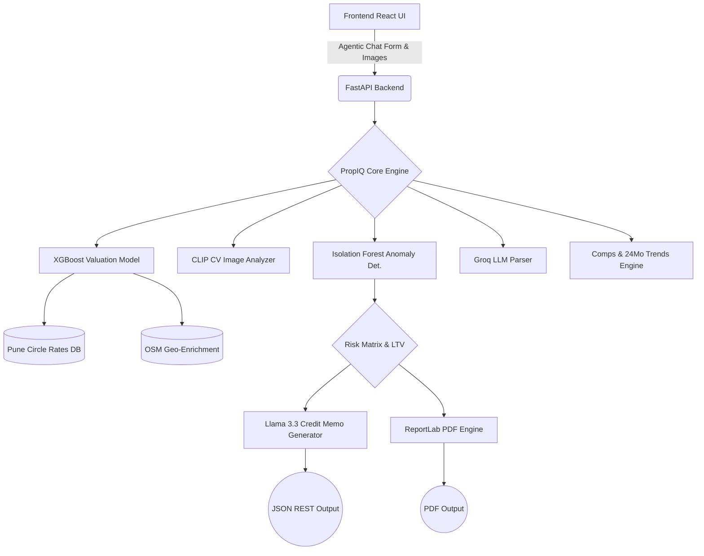

# 🏢 PropIQ — Agentic Collateral Intelligence Pipeline

**PropIQ is a production-ready, AI-powered collateral valuation and liquidity intelligence engine built specifically for NBFC/LAP (Loan Against Property) underwriting workflows.**

PropIQ replaces the manual 3-5 day real-estate valuation process with a 90-second automated AI assessment. It acts as an autonomous underwriter—taking natural language inputs, structurally analyzing property images, executing complex ML valuations, and directly outputting an RBI-compliant bank credit memo. 

Built for the **TenzorX 2026 — Poonawalla Fincorp National AI Hackathon**.

---

## ⚡ OUR USP's : 

We went entirely beyond a standard chatbot/estimation model. PropIQ is a comprehensive lending OS:

1. **Agentic Auto-Valuation (LLM):** Users can type *"Evaluate a 10-yr old 2bhk in Baner"* in the chat. The system automatically structures the JSON and fires the end-to-end ML pipeline with zero form entry.
2. **Multimodal Computer Vision (Zero-Shot CLIP):** Upload *multiple* interior/exterior images simultaneously. The engine understands structural condition visually and actively haircuts or uplifts the final property valuation.
3. **LLM Credit Memos (Llama 3.3 70B):** Generates a human-readable, professional underwriting credit note spanning risk, liquidity, and recommendations.
4. **Enterprise Batch Portfolio Screening:** Secure CSV upload allowing NBFCs to process and analyze up to 50 collateral properties synchronously for bulk portfolio stress testing.
5. **Explainable AI (SHAP):** Transparent predictions displaying exactly which features (size, local infra, age) mathematically drove the property's valuation in INR.
6. **RBI-Compliant LTV Engine:** Calculates maximum safe loan amounts dynamically based on property type, local zone tiers (Prime/Mid), and system risk flags.
7. **Synthetic Comparable Sales (Comps):** Real-time NLP retrieval of nearby authentic comparable property transactions to justify the estimate.
8. **Liquidity Risk Modeling:** Calculates a Resale Potential Index (RPI) and Estimated Time to Liquidate based on property characteristics.
9. **Automated Audit Logs:** SQLite backed persistence for transparent compliance audits.
10. **Rich React Aesthetics:** A stunning, premium frontend with dynamic charting, dashboards, and split-screen workflow layouts.
11. **RBI-Ready Audit Reports:** Instant, one-click PDF generation of the entire valuation output.

---

## 🏗️ System Architecture



---

## 🚀 Running PropIQ Locally

### Prerequisites
- Python 3.10+
- Node.js v18+
- Groq API Key (If running LLM endpoints locally limit)

### 1. Backend Setup
```bash
cd backend
python -m venv venv

# Windows
venv\Scripts\activate
# Mac/Linux
source venv/bin/activate

pip install -r requirements.txt
# Generates the synthetic data and trains the `.pkl` XGBoost model locally for your env
python -m app.ml.data_generator
python -m app.ml.valuation_model

uvicorn app.main:app --reload --port 8000
```

### 2. Frontend Setup
```bash
cd frontend
npm install
npm start
```
The application will be running at `http://localhost:3000`.

---

## 🌐 API Endpoints

PropIQ is a fully documented, production-ready REST API. Visit `http://localhost:8000/docs` while running for the interactive Swagger interface.

| Method | Endpoint | Description |
|--------|----------|-------------|
| `POST` | `/api/v1/assess` | Standard full valuation model inference |
| `POST` | `/api/v1/chat` | **[AGENTIC]** Natural language property setup & assessment |
| `POST` | `/api/v1/assess/image` | **[CV]** Assessment + Multi-image structural grading |
| `POST` | `/api/v1/assess/full` | **[KITCHEN-SINK]** Valuation + Comps + Trends + LTV + Narratives |
| `POST` | `/api/v1/assess/narrate` | **[LLM]** Valuation returning generated Credit Memo |
| `POST` | `/api/v1/assess/batch` | **[PORTFOLIO]** Bulk assessment execution (up to 50) |
| `POST` | `/api/v1/assess/pdf` | Generates formatted PDF download |
| `GET` | `/api/v1/comps` | Query comparable sales in the geo-cluster |
| `GET` | `/api/v1/audit/recent` | SQLite backed system audit logs |

---

