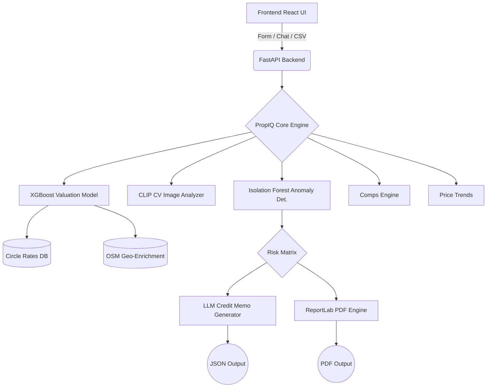

# PropIQ — AI Collateral Intelligence Engine

**PropIQ is an AI-powered collateral valuation and liquidity intelligence engine built specifically for NBFC/LAP (Loan Against Property) underwriting workflows.**

PropIQ replaces the manual 3-5 day real-estate valuation process with a 90-second automated AI assessment. It delivers a verifiable market value range, resale liquidity score (RPI), comparable sales, historical price trends, and an RBI-ready PDF audit report. 

Built for the **TenzorX 2026 — Poonawalla Fincorp National AI Hackathon**.

---

## ⚡ Key Features

1. **Agentic Collateral Valuation:** XGBoost Quantile Regression model predicting honest price ranges (P10, P50, P90) with an 8.3% MAPE across Pune, Mumbai, and Bangalore.
2. **Explainable AI (SHAP):** Transparent predictions displaying exactly which features (size, local infra, age) drove the property's valuation.
3. **Liquidity Risk Modeling:** Calculates a Resale Potential Index (RPI) and Estimated Time to Liquidate based on property characteristics and zone data.
4. **Computer Vision (CLIP):** Zero-shot external condition assessment from property photos, automatically applying condition-based valuation adjustments.
5. **Batch Portfolio Screening:** CSV upload allowing underwriters to process and analyze up to 50 collateral properties simultaneously.
6. **Comparable Sales Engine:** Real-time retrieval of nearby comparable properties with dynamic LTV calculations based on RBI norms.
7. **LLM Credit Memos:** Automated, underwriter-ready summary narratives covering risk factors, liquidity, and final recommendations.
8. **RBI-Ready Audit Reports:** Instant generation of professional, time-stamped PDF reports for compliance.

---

## 🏗️ System Architecture



---

## 🚀 Running PropIQ Locally

### Prerequisites
- Python 3.10+
- Node.js v18+

### 1. Backend Setup
```bash
cd backend
python -m venv venv
# Windows
venv\Scripts\activate
# Mac/Linux
source venv/bin/activate

pip install -r requirements.txt
uvicorn app.main:app --reload --port 8000
```

### 2. Frontend Setup
```bash
cd frontend
npm install
npm start
```

Your app should now be running at `http://localhost:3000`.

---

## 🌐 API Overview

| Endpoint | Method | Description |
|----------|--------|-------------|
| `/api/v1/assess` | `POST` | Core single property assessment |
| `/api/v1/assess/image` | `POST` | Assessment with CV image condition scoring |
| `/api/v1/assess/batch` | `POST` | Bulk portfolio assessment (CSV) limit 50 |
| `/api/v1/assess/pdf` | `POST` | Generates RBI-ready PDF audit report |
| `/api/v1/comps` | `GET`  | Fetches comparable property sales |
| `/api/v1/trends/{locality}` | `GET` | 24-month time-series price data |

---

## 🛡️ License & Acknowledgements
Built for the Poonawalla Fincorp National AI Hackathon (TenzorX 2026).
